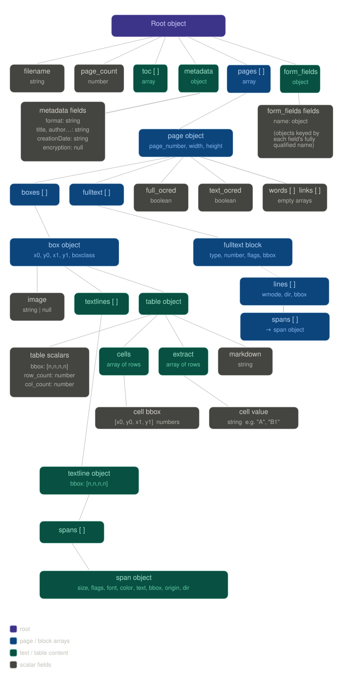

.. include:: header.rst

JSON Schema
===========

Full field reference for the structured output returned by :meth:`Document.to_json`.

Overview
--------

:meth:`Document.to_json` returns a list of page objects — one per extracted page. Each page contains a list of blocks (``boxes``), and each block contains type-specific fields. This page documents every object and field in the output hierarchy.

.. note::
      The JSON output structure is illustrated in the image above. It provides a hierarchical representation of the document's content, including text, images, and layout information.
      Positional coordinates are in PDF points (1 point = 1/72 inch). The origin (0, 0) is the top-left corner of the unrotated page.

Full example
------------

.. raw:: html

   

   
Show full example

.. code-block:: json

   {
      "filename": "hello-world.pdf",
      "page_count": 2,
      "toc": [],
      "pages": [
        {
          "page_number": 1,
          "width": 595.2000122070312,
          "height": 841.9199829101562,
          "boxes": [
            {
              "x0": 72,
              "y0": 71.99996948242188,
              "x1": 334.470947265625,
              "y1": 273.3801574707031,
              "boxclass": "picture",
              "image": null,
              "table": null,
              "max_fontsize": null,
              "header_level": 0,
              "textlines": []
            },
            {
              "x0": 70.69100189208984,
              "y0": 295.880126953125,
              "x1": 197.2770233154297,
              "y1": 304.6259765625,
              "boxclass": "caption",
              "image": null,
              "table": null,
              "max_fontsize": null,
              "header_level": 0,
              "textlines": [
                {
                  "bbox": [
                    70.69100189208984,
                    295.880126953125,
                    197.2770233154297,
                    304.6259765625
                  ],
                  "spans": [
                    {
                      "size": 12,
                      "flags": 0,
                      "bidi": 0,
                      "char_flags": 16,
                      "font": "Arial",
                      "color": 0,
                      "alpha": 255,
                      "ascender": 0.800000011920929,
                      "descender": -0.20000000298023224,
                      "text": "Hello World!",
                      "origin": [
                        70.69100189208984,
                        304.469970703125
                      ],
                      "bbox": [
                        70.69100189208984,
                        295.880126953125,
                        136.09201049804688,
                        304.6259765625
                      ],
                      "line": 0,
                      "block": 0,
                      "dir": [
                        1,
                        0
                      ]
                    },
                    {
                      "size": 12,
                      "flags": 20,
                      "bidi": 0,
                      "char_flags": 24,
                      "font": "MinionPro-Bold",
                      "color": 0,
                      "alpha": 255,
                      "ascender": 0.800000011920929,
                      "descender": -0.20000000298023224,
                      "text": "This is bold",
                      "origin": [
                        138.8310089111328,
                        304.469970703125
                      ],
                      "bbox": [
                        138.8310089111328,
                        295.880126953125,
                        197.2770233154297,
                        304.6259765625
                      ],
                      "line": 0,
                      "block": 0,
                      "dir": [
                        1,
                        0
                      ]
                    }
                  ]
                }
              ]
            },
            {
              "x0": 217.9209442138672,
              "y0": 405.69598388671875,
              "x1": 321.60137939453125,
              "y1": 413.6759948730469,
              "boxclass": "section-header",
              "image": null,
              "table": null,
              "max_fontsize": 106,
              "header_level": 1,
              "textlines": [
                {
                  "bbox": [
                    217.9209442138672,
                    405.69598388671875,
                    321.60137939453125,
                    413.6759948730469
                  ],
                  "spans": [
                    {
                      "size": 105.582763671875,
                      "flags": 0,
                      "bidi": 0,
                      "char_flags": 17,
                      "font": "Droid Sans Fallback Regular",
                      "color": 0,
                      "alpha": 255,
                      "ascender": 0.800000011920929,
                      "descender": -0.20000000298023224,
                      "text": "一",
                      "origin": [
                        217.9209442138672,
                        452.7359924316406
                      ],
                      "bbox": [
                        217.9209442138672,
                        405.69598388671875,
                        321.60137939453125,
                        413.6759948730469
                      ],
                      "line": 0,
                      "block": 1,
                      "dir": [
                        1,
                        0
                      ]
                    }
                  ]
                }
              ]
            }
          ],
          "full_ocred": false,
          "fulltext": [
            {
              "type": 0,
              "number": 0,
              "flags": 0,
              "bbox": [
                70.69100189208984,
                295.880126953125,
                197.2770233154297,
                304.6259765625
              ],
              "lines": [
                {
                  "spans": [
                    {
                      "size": 12,
                      "flags": 0,
                      "bidi": 0,
                      "char_flags": 16,
                      "font": "Arial",
                      "color": 0,
                      "alpha": 255,
                      "ascender": 0.800000011920929,
                      "descender": -0.20000000298023224,
                      "text": "Hello World!",
                      "origin": [
                        70.69100189208984,
                        304.469970703125
                      ],
                      "bbox": [
                        70.69100189208984,
                        295.880126953125,
                        136.09201049804688,
                        304.6259765625
                      ],
                      "line": 0,
                      "block": 0,
                      "dir": [
                        1,
                        0
                      ]
                    },
                    {
                      "size": 12,
                      "flags": 4,
                      "bidi": 0,
                      "char_flags": 16,
                      "font": "MinionPro-Regular",
                      "color": 0,
                      "alpha": 255,
                      "ascender": 0.800000011920929,
                      "descender": -0.20000000298023224,
                      "text": " ",
                      "origin": [
                        136.09201049804688,
                        304.469970703125
                      ],
                      "bbox": [
                        136.09201049804688,
                        304.469970703125,
                        138.81600952148438,
                        304.469970703125
                      ]
                    },
                    {
                      "size": 12,
                      "flags": 20,
                      "bidi": 0,
                      "char_flags": 24,
                      "font": "MinionPro-Bold",
                      "color": 0,
                      "alpha": 255,
                      "ascender": 0.800000011920929,
                      "descender": -0.20000000298023224,
                      "text": "This is bold",
                      "origin": [
                        138.8310089111328,
                        304.469970703125
                      ],
                      "bbox": [
                        138.8310089111328,
                        295.880126953125,
                        197.2770233154297,
                        304.6259765625
                      ],
                      "line": 0,
                      "block": 0,
                      "dir": [
                        1,
                        0
                      ]
                    }
                  ],
                  "wmode": 0,
                  "dir": [
                    1,
                    0
                  ],
                  "bbox": [
                    70.69100189208984,
                    295.880126953125,
                    197.2770233154297,
                    304.6259765625
                  ]
                }
              ]
            },
            {
              "type": 0,
              "number": 2,
              "flags": 0,
              "bbox": [
                217.9209442138672,
                405.69598388671875,
                321.60137939453125,
                413.6759948730469
              ],
              "lines": [
                {
                  "spans": [
                    {
                      "size": 105.582763671875,
                      "flags": 0,
                      "bidi": 0,
                      "char_flags": 17,
                      "font": "Droid Sans Fallback Regular",
                      "color": 0,
                      "alpha": 255,
                      "ascender": 0.800000011920929,
                      "descender": -0.20000000298023224,
                      "text": "一",
                      "origin": [
                        217.9209442138672,
                        452.7359924316406
                      ],
                      "bbox": [
                        217.9209442138672,
                        405.69598388671875,
                        321.60137939453125,
                        413.6759948730469
                      ],
                      "line": 0,
                      "block": 1,
                      "dir": [
                        1,
                        0
                      ]
                    }
                  ],
                  "wmode": 0,
                  "dir": [
                    1,
                    0
                  ],
                  "bbox": [
                    217.9209442138672,
                    405.69598388671875,
                    321.60137939453125,
                    413.6759948730469
                  ]
                }
              ]
            }
          ],
          "words": [],
          "links": []
        },
        {
          "page_number": 2,
          "width": 595.2000122070312,
          "height": 841.9199829101562,
          "boxes": [
            {
              "x0": 77.76000213623047,
              "y0": 75.767822265625,
              "x1": 432.7583923339844,
              "y1": 114.10546875,
              "boxclass": "table",
              "image": null,
              "table": {
                "bbox": [
                  77.76000213623047,
                  75.767822265625,
                  432.7583923339844,
                  114.10546875
                ],
                "row_count": 3,
                "col_count": 4,
                "cells": [
                  [
                    [
                      77.76000213623047,
                      75.767822265625,
                      140.69349010288715,
                      87.98583588004112
                    ],
                    [
                      140.69349010288715,
                      75.767822265625,
                      254.1836319565773,
                      87.98583588004112
                    ],
                    [
                      254.1836319565773,
                      75.767822265625,
                      366.22625809907913,
                      87.98583588004112
                    ],
                    [
                      366.22625809907913,
                      75.767822265625,
                      432.7583923339844,
                      87.98583588004112
                    ]
                  ],
                  [
                    [
                      77.76000213623047,
                      87.98583588004112,
                      140.69349010288715,
                      102.90197920799255
                    ],
                    [
                      140.69349010288715,
                      87.98583588004112,
                      254.1836319565773,
                      102.90197920799255
                    ],
                    [
                      254.1836319565773,
                      87.98583588004112,
                      366.22625809907913,
                      102.90197920799255
                    ],
                    [
                      366.22625809907913,
                      87.98583588004112,
                      432.7583923339844,
                      102.90197920799255
                    ]
                  ],
                  [
                    [
                      77.76000213623047,
                      102.90197920799255,
                      140.69349010288715,
                      114.10546875
                    ],
                    [
                      140.69349010288715,
                      102.90197920799255,
                      254.1836319565773,
                      114.10546875
                    ],
                    [
                      254.1836319565773,
                      102.90197920799255,
                      366.22625809907913,
                      114.10546875
                    ],
                    [
                      366.22625809907913,
                      102.90197920799255,
                      432.7583923339844,
                      114.10546875
                    ]
                  ]
                ],
                "extract": [
                  [
                    "A",
                    "B",
                    "C",
                    "D"
                  ],
                  [
                    "A1",
                    "B1",
                    "C1",
                    "D1"
                  ],
                  [
                    "A2",
                    "B2",
                    "C2",
                    "D2"
                  ]
                ],
                "markdown": "|A|B|C|D|\n|---|---|---|---|\n|A1|B1|C1|D1|\n|A2|B2|C2|D2|\n\n"
              },
              "max_fontsize": null,
              "header_level": 0,
              "textlines": null
            }
          ],
          "full_ocred": false,
          "fulltext": [
            {
              "type": 0,
              "number": 0,
              "flags": 0,
              "bbox": [
                77.76000213623047,
                75.767822265625,
                426.34820556640625,
                83.865478515625
              ],
              "lines": [
                {
                  "spans": [
                    {
                      "size": 12,
                      "flags": 4,
                      "bidi": 0,
                      "char_flags": 16,
                      "font": "Aptos",
                      "color": 0,
                      "alpha": 255,
                      "ascender": 0.800000011920929,
                      "descender": -0.20000000298023224,
                      "text": "A ",
                      "origin": [
                        77.76000213623047,
                        83.760009765625
                      ],
                      "bbox": [
                        77.76000213623047,
                        75.873291015625,
                        87.26829528808594,
                        83.760009765625
                      ]
                    }
                  ],
                  "wmode": 0,
                  "dir": [
                    1,
                    0
                  ],
                  "bbox": [
                    77.76000213623047,
                    75.873291015625,
                    87.26829528808594,
                    83.760009765625
                  ]
                },
                {
                  "spans": [
                    {
                      "size": 12,
                      "flags": 4,
                      "bidi": 0,
                      "char_flags": 16,
                      "font": "Aptos",
                      "color": 0,
                      "alpha": 255,
                      "ascender": 0.800000011920929,
                      "descender": -0.20000000298023224,
                      "text": "B ",
                      "origin": [
                        190.32000732421875,
                        83.760009765625
                      ],
                      "bbox": [
                        190.32000732421875,
                        75.873291015625,
                        200.0041046142578,
                        83.760009765625
                      ]
                    }
                  ],
                  "wmode": 0,
                  "dir": [
                    1,
                    0
                  ],
                  "bbox": [
                    190.32000732421875,
                    75.873291015625,
                    200.0041046142578,
                    83.760009765625
                  ]
                },
                {
                  "spans": [
                    {
                      "size": 12,
                      "flags": 4,
                      "bidi": 0,
                      "char_flags": 16,
                      "font": "Aptos",
                      "color": 0,
                      "alpha": 255,
                      "ascender": 0.800000011920929,
                      "descender": -0.20000000298023224,
                      "text": "C ",
                      "origin": [
                        303.1199951171875,
                        83.760009765625
                      ],
                      "bbox": [
                        303.1199951171875,
                        75.767822265625,
                        313.86480712890625,
                        83.865478515625
                      ]
                    }
                  ],
                  "wmode": 0,
                  "dir": [
                    1,
                    0
                  ],
                  "bbox": [
                    303.1199951171875,
                    75.767822265625,
                    313.86480712890625,
                    83.865478515625
                  ]
                },
                {
                  "spans": [
                    {
                      "size": 12,
                      "flags": 4,
                      "bidi": 0,
                      "char_flags": 16,
                      "font": "Aptos",
                      "color": 0,
                      "alpha": 255,
                      "ascender": 0.800000011920929,
                      "descender": -0.20000000298023224,
                      "text": "D ",
                      "origin": [
                        415.67999267578125,
                        83.760009765625
                      ],
                      "bbox": [
                        415.67999267578125,
                        75.873291015625,
                        426.34820556640625,
                        83.760009765625
                      ]
                    }
                  ],
                  "wmode": 0,
                  "dir": [
                    1,
                    0
                  ],
                  "bbox": [
                    415.67999267578125,
                    75.873291015625,
                    426.34820556640625,
                    83.760009765625
                  ]
                }
              ]
            },
            {
              "type": 0,
              "number": 11,
              "flags": 0,
              "bbox": [
                77.76000213623047,
                90.8878173828125,
                432.7583923339844,
                98.9854736328125
              ],
              "lines": [
                {
                  "spans": [
                    {
                      "size": 12,
                      "flags": 4,
                      "bidi": 0,
                      "char_flags": 16,
                      "font": "Aptos",
                      "color": 0,
                      "alpha": 255,
                      "ascender": 0.800000011920929,
                      "descender": -0.20000000298023224,
                      "text": "A1 ",
                      "origin": [
                        77.76000213623047,
                        98.8800048828125
                      ],
                      "bbox": [
                        77.76000213623047,
                        90.9932861328125,
                        93.67839813232422,
                        98.8800048828125
                      ]
                    }
                  ],
                  "wmode": 0,
                  "dir": [
                    1,
                    0
                  ],
                  "bbox": [
                    77.76000213623047,
                    90.9932861328125,
                    93.67839813232422,
                    98.8800048828125
                  ]
                },
                {
                  "spans": [
                    {
                      "size": 12,
                      "flags": 4,
                      "bidi": 0,
                      "char_flags": 16,
                      "font": "Aptos",
                      "color": 0,
                      "alpha": 255,
                      "ascender": 0.800000011920929,
                      "descender": -0.20000000298023224,
                      "text": "B1 ",
                      "origin": [
                        190.32000732421875,
                        98.8800048828125
                      ],
                      "bbox": [
                        190.32000732421875,
                        90.9932861328125,
                        206.414306640625,
                        98.8800048828125
                      ]
                    }
                  ],
                  "wmode": 0,
                  "dir": [
                    1,
                    0
                  ],
                  "bbox": [
                    190.32000732421875,
                    90.9932861328125,
                    206.414306640625,
                    98.8800048828125
                  ]
                },
                {
                  "spans": [
                    {
                      "size": 12,
                      "flags": 4,
                      "bidi": 0,
                      "char_flags": 16,
                      "font": "Aptos",
                      "color": 0,
                      "alpha": 255,
                      "ascender": 0.800000011920929,
                      "descender": -0.20000000298023224,
                      "text": "C1 ",
                      "origin": [
                        303.1199951171875,
                        98.8800048828125
                      ],
                      "bbox": [
                        303.1199951171875,
                        90.8878173828125,
                        320.2749938964844,
                        98.9854736328125
                      ]
                    }
                  ],
                  "wmode": 0,
                  "dir": [
                    1,
                    0
                  ],
                  "bbox": [
                    303.1199951171875,
                    90.8878173828125,
                    320.2749938964844,
                    98.9854736328125
                  ]
                },
                {
                  "spans": [
                    {
                      "size": 12,
                      "flags": 4,
                      "bidi": 0,
                      "char_flags": 16,
                      "font": "Aptos",
                      "color": 0,
                      "alpha": 255,
                      "ascender": 0.800000011920929,
                      "descender": -0.20000000298023224,
                      "text": "D1 ",
                      "origin": [
                        415.67999267578125,
                        98.8800048828125
                      ],
                      "bbox": [
                        415.67999267578125,
                        90.9932861328125,
                        432.7583923339844,
                        98.8800048828125
                      ]
                    }
                  ],
                  "wmode": 0,
                  "dir": [
                    1,
                    0
                  ],
                  "bbox": [
                    415.67999267578125,
                    90.9932861328125,
                    432.7583923339844,
                    98.8800048828125
                  ]
                }
              ]
            },
            {
              "type": 0,
              "number": 22,
              "flags": 0,
              "bbox": [
                77.76000213623047,
                106.0078125,
                432.7583923339844,
                114.10546875
              ],
              "lines": [
                {
                  "spans": [
                    {
                      "size": 12,
                      "flags": 4,
                      "bidi": 0,
                      "char_flags": 16,
                      "font": "Aptos",
                      "color": 0,
                      "alpha": 255,
                      "ascender": 0.800000011920929,
                      "descender": -0.20000000298023224,
                      "text": "A2 ",
                      "origin": [
                        77.76000213623047,
                        114
                      ],
                      "bbox": [
                        77.76000213623047,
                        106.11328125,
                        93.67839813232422,
                        114
                      ]
                    }
                  ],
                  "wmode": 0,
                  "dir": [
                    1,
                    0
                  ],
                  "bbox": [
                    77.76000213623047,
                    106.11328125,
                    93.67839813232422,
                    114
                  ]
                },
                {
                  "spans": [
                    {
                      "size": 12,
                      "flags": 4,
                      "bidi": 0,
                      "char_flags": 16,
                      "font": "Aptos",
                      "color": 0,
                      "alpha": 255,
                      "ascender": 0.800000011920929,
                      "descender": -0.20000000298023224,
                      "text": "B2 ",
                      "origin": [
                        190.32000732421875,
                        114
                      ],
                      "bbox": [
                        190.32000732421875,
                        106.11328125,
                        206.414306640625,
                        114
                      ]
                    }
                  ],
                  "wmode": 0,
                  "dir": [
                    1,
                    0
                  ],
                  "bbox": [
                    190.32000732421875,
                    106.11328125,
                    206.414306640625,
                    114
                  ]
                },
                {
                  "spans": [
                    {
                      "size": 12,
                      "flags": 4,
                      "bidi": 0,
                      "char_flags": 16,
                      "font": "Aptos",
                      "color": 0,
                      "alpha": 255,
                      "ascender": 0.800000011920929,
                      "descender": -0.20000000298023224,
                      "text": "C2 ",
                      "origin": [
                        303.1199951171875,
                        114
                      ],
                      "bbox": [
                        303.1199951171875,
                        106.0078125,
                        320.2749938964844,
                        114.10546875
                      ]
                    }
                  ],
                  "wmode": 0,
                  "dir": [
                    1,
                    0
                  ],
                  "bbox": [
                    303.1199951171875,
                    106.0078125,
                    320.2749938964844,
                    114.10546875
                  ]
                },
                {
                  "spans": [
                    {
                      "size": 12,
                      "flags": 4,
                      "bidi": 0,
                      "char_flags": 16,
                      "font": "Aptos",
                      "color": 0,
                      "alpha": 255,
                      "ascender": 0.800000011920929,
                      "descender": -0.20000000298023224,
                      "text": "D2 ",
                      "origin": [
                        415.67999267578125,
                        114
                      ],
                      "bbox": [
                        415.67999267578125,
                        106.11328125,
                        432.7583923339844,
                        114
                      ]
                    }
                  ],
                  "wmode": 0,
                  "dir": [
                    1,
                    0
                  ],
                  "bbox": [
                    415.67999267578125,
                    106.11328125,
                    432.7583923339844,
                    114
                  ]
                }
              ]
            }
          ],
          "words": [],
          "links": []
        }
      ],
      "metadata": {
        "format": "PDF 1.6",
        "title": "",
        "author": "",
        "subject": "",
        "keywords": "",
        "creator": "",
        "producer": "macOS Version 13.6.4 (Build 22G513) Quartz PDFContext",
        "creationDate": "D:20240722172345Z",
        "modDate": "D:20261111143026Z",
        "trapped": "",
        "encryption": null
      },
      "from_bytes": false,
      "image_dpi": 150,
      "image_format": "png",
      "image_path": "",
      "use_ocr": true,
      "form_fields": {
        "Input Text 1": {
          "field_value": "",
          "pages": [
            0
          ],
          "terminal": true
        },
        "Input Text 2": {
          "field_value": "",
          "pages": [
            1
          ],
          "terminal": true
        }
      },
      "force_text": true,
      "embed_images": false,
      "write_images": false
    }

.. raw:: html

   

The extraction response is a single JSON object describing a parsed PDF — its pages, text content, tables, images, and metadata. This page documents every object and field in that structure with positional data.

.. note::

   Positional coordinates are in PDF points (1 point = 1/72 inch). The origin ``(0, 0)`` is the **top-left** corner of the unrotated page.

.. _json-schema-root-object:

Root object
-----------

The top-level object returned for every extraction.

.. rubric:: Example

.. code-block:: json

   {
     "filename": "hello-world.pdf",
     "page_count": 2,
     "toc": [],
     "pages": [...],
     "metadata": {...}
   }

``filename`` (*string*)
   The name of the source PDF file that was parsed.

``page_count`` (*number*)
   Total number of pages in the PDF.

``toc`` (*array*)
   Table of contents entries extracted from the PDF. Each entry is a tuple of
   ``[page_index, title, page_number]``. Empty when the PDF has no bookmarks or
   outline.

``pages`` (*array*)
   Array of :ref:`page objects <json-schema-page-object>`, one per page in the PDF.

``metadata`` (*object*)
   PDF document metadata. See :ref:`metadata object <json-schema-metadata-object>`.

``form_fields`` (*object*)
   Interactive form fields and their values, keyed by fully qualified field
   name. Empty when the PDF has no form fields. See :ref:`form fields <json-schema-form-fields-object>`.

----

.. _json-schema-page-object:

Page object
-----------

Represents a single page of the PDF. Found in ``pages[]``.

.. rubric:: Example

.. code-block:: json

   {
     "page_number": 1,
     "width": 595.2,
     "height": 841.92,
     "boxes": [...],
     "fulltext": [...],
     "full_ocred": false,
     "text_ocred": false,
     "words": [],
     "links": []
   }

``page_number`` (*number*)
   1-based index of this page within the document.

``width`` (*number*)
   Page width in PDF user units (points). A standard A4 page is 595.28 pt wide.

``height`` (*number*)
   Page height in PDF user units (points). A standard A4 page is 841.89 pt tall.

``boxes`` (*array*)
   Detected content regions on the page. Each entry is a :ref:`box object <json-schema-box-object>`.
   Boxes may be classified as ``text``, ``picture``, or ``table``.

``fulltext`` (*array*)
   Raw text blocks extracted directly from the PDF's content stream, independent
   of the box layout. Each entry is a :ref:`fulltext block <json-schema-fulltext-block>`. This
   mirrors the logical reading order as encoded in the PDF.

``full_ocred`` (*boolean*)
   ``true`` if the entire page was processed through OCR because no native text
   layer was found.

``text_ocred`` (*boolean*)
   ``true`` if individual text regions were OCR'd (as opposed to full-page OCR).

``words`` (*array*)
   Word-level bounding boxes. Empty in this format variant. To get word positions use :meth:`Page.get_text` with the "words" option.

``links`` (*array*)
   Hyperlinks found on the page. Empty when no links are present.

----

.. _json-schema-box-object:

Box object
----------

A detected content region on a page. Found in ``pages[].boxes[]``.

Boxes are the primary layout unit.

Each box covers a rectangular area and is classified into one of these types:

.. code-block:: text

   text
   picture
   table
   caption
   title
   section-header
   page-header
   page-footer
   list-item
   footnote
   formula

.. rubric:: Text box example

.. code-block:: json

   {
     "x0": 70.69,
     "y0": 295.88,
     "x1": 197.28,
     "y1": 304.63,
     "boxclass": "text",
     "image": null,
     "table": null,
     "textlines": [...]
   }

.. rubric:: Picture box example

.. code-block:: json

   {
     "x0": 72,
     "y0": 72,
     "x1": 334.47,
     "y1": 273.38,
     "boxclass": "picture",
     "image": "images/hello-world.pdf-0001-00.png",
     "table": null,
     "textlines": []
   }

.. rubric:: Table box example

.. code-block:: json

   {
     "x0": 72,
     "y0": 72,
     "x1": 524,
     "y1": 118,
     "boxclass": "table",
     "image": null,
     "table": {...},
     "textlines": null
   }

``x0`` (*number*)
   Left edge of the box in PDF points, measured from the left of the page.

``y0`` (*number*)
   Top edge of the box in PDF points, measured from the top of the page.

``x1`` (*number*)
   Right edge of the box in PDF points.

``y1`` (*number*)
   Bottom edge of the box in PDF points.

``boxclass`` (*string*)
   Classification of the content region. One of:

   - ``"text"`` — contains text lines and spans
   - ``"picture"`` — contains an embedded image
   - ``"table"`` — contains a detected table structure

``image`` (*string | null*)
   Relative path to the extracted image file when ``boxclass`` is ``"picture"``.
   ``null`` for all other box types.

``table`` (*object | null*)
   A :ref:`table object <json-schema-table-object>` when ``boxclass`` is ``"table"``. ``null`` for all
   other box types.

``textlines`` (*array | null*)
   Array of :ref:`textline objects <json-schema-textline-object>` when ``boxclass`` is ``"text"``.
   Empty array ``[]`` for picture boxes. ``null`` for table boxes.

----

.. _json-schema-table-object:

Table object
------------

Structured data for a detected table. Found in ``boxes[].table`` when
``boxclass`` is ``"table"``.

.. rubric:: Example

.. code-block:: json

   {
     "bbox": [71.15, 72.19, 523.22, 117.68],
     "row_count": 3,
     "col_count": 4,
     "cells": [
       [[71.15, 72.19, 184.6, 87.36], [184.6, 72.19, 297.16, 87.36], ...],
       ...
     ],
     "extract": [
       ["A", "B", "C", "D"],
       ["A1", "B1", "C1", "D1"],
       ["A2", "B2", "C2", "D2"]
     ],
     "markdown": "|A|B|C|D|\n|---|---|---|---|\n|A1|B1|C1|D1|\n|A2|B2|C2|D2|\n\n"
   }

``bbox`` (*number[4]*)
   Bounding box of the entire table as ``[x0, y0, x1, y1]`` in PDF points.

``row_count`` (*number*)
   Number of rows in the table, including any header row.

``col_count`` (*number*)
   Number of columns in the table.

``cells`` (*array*)
   A 3D array of cell bounding boxes: ``cells[row][col]`` gives ``[x0, y0, x1, y1]``
   for that cell in PDF points. Useful for mapping extracted text back to exact
   cell positions on the page.

``extract`` (*array*)
   A 2D array of the cell text values: ``extract[row][col]`` gives the string
   content of that cell. The first row is typically the header row.

``markdown`` (*string*)
   The table rendered as a Markdown pipe table string, ready for display or
   further processing.

----

.. _json-schema-textline-object:

Textline object
---------------

A single line of text within a box. Found in ``boxes[].textlines[]``.

.. rubric:: Example

.. code-block:: json

   {
     "bbox": [70.69, 295.88, 197.28, 304.63],
     "spans": [...]
   }

``bbox`` (*number[4]*)
   Bounding box of this text line as ``[x0, y0, x1, y1]`` in PDF points.

``spans`` (*array*)
   Array of :ref:`span objects <json-schema-span-object>`. A single line is typically split into
   multiple spans wherever the font, size, or style changes.

----

.. _json-schema-span-object:

Span object
-----------

The smallest unit of text, sharing a single consistent style. Found in
``textlines[].spans[]`` and ``fulltext[].lines[].spans[]``.

A span break occurs at any change of font, size, weight, colour, or style — so
a line reading "Hello World! **This is bold**" would produce
two separate spans. See :ref:`json-schema-flags` for how to interpret the ``flags`` field.

.. rubric:: Example — regular text

.. code-block:: json

   {
     "size": 12,
     "flags": 0,
     "bidi": 0,
     "char_flags": 16,
     "font": "Arial",
     "color": 0,
     "alpha": 255,
     "ascender": 0.8,
     "descender": -0.2,
     "text": "Hello World!",
     "origin": [70.69, 304.47],
     "bbox": [70.69, 295.88, 136.09, 304.61],
     "line": 0,
     "block": 0,
     "dir": [1, 0]
   }

.. rubric:: Example — bold text

.. code-block:: json

   {
     "size": 12,
     "flags": 16,
     "bidi": 0,
     "char_flags": 24,
     "font": "MinionPro-Bold",
     "color": 0,
     "alpha": 255,
     "ascender": 0.8,
     "descender": -0.2,
     "text": "This is bold",
     "origin": [138.83, 304.47],
     "bbox": [138.83, 296.03, 197.28, 304.63],
     "line": 0,
     "block": 0,
     "dir": [1, 0]
   }

``text`` (*string*)
   The actual text content of this span.

``font`` (*string*)
   Full PostScript font name, e.g. ``"Arial"``, ``"MinionPro-Bold"``, ``"Aptos"``.
   The font name often encodes weight and style (e.g. ``-Bold``, ``-It``).

``size`` (*number*)
   Font size in points.

.. _json-schema-flags:

``flags`` (*number*)
   Bitmask of font style flags from the PDF spec. Common values:

   - ``0`` — regular
   - ``4`` — italic (bit 2)
   - ``16`` — bold (bit 4)
   - ``20`` — bold + italic (bits 2 and 4)

``char_flags`` (*number*)
   Additional character flags - please refer to `this enumeration <https://github.com/ArtifexSoftware/mupdf/blob/66ef5879c18bc7cc0831fd9b915b257ab717b79e/include/mupdf/fitz/structured-text.h#L489>`_ for details.

``color`` (*number*)
   Text colour as a packed RGB integer. ``0`` is black (``#000000``).

``alpha`` (*number*)
   Opacity of the text, from ``0`` (transparent) to ``255`` (fully opaque).

``ascender`` (*number*)
   Font ascender as a fraction of the font size. Typically ``0.8``, meaning the
   ascender reaches 80% of the em above the baseline.

``descender`` (*number*)
   Font descender as a fraction of the font size. Typically ``-0.2``, meaning the
   descender extends 20% of the em below the baseline.

``bbox`` (*number[4]*)
   Tight bounding box of the rendered glyphs as ``[x0, y0, x1, y1]`` in PDF points.

``origin`` (*number[2]*)
   The text origin point ``[x, y]`` — the position of the baseline at the start
   of the span, in PDF points.

``bidi`` (*number*)
   Unicode bidirectional level. ``0`` for left-to-right text.

``line`` (*number*)
   Index of the line this span belongs to within its parent block.

``block`` (*number*)
   Index of the block this span belongs to within the page's content stream.

``dir`` (*number[2]*)
   Text direction as a unit vector ``[x, y]``. ``[1, 0]`` is standard
   left-to-right horizontal text. ``[0, -1]`` would indicate top-to-bottom
   vertical text.

----

.. _json-schema-fulltext-block:

Fulltext block
--------------

A raw text block from the PDF content stream, independent of visual layout.
Found in ``pages[].fulltext[]``.

The ``fulltext`` array captures text in the order it appears in the PDF's
internal stream, which may differ from the visual reading order. Each block
contains one or more lines, and each line contains spans.

.. rubric:: Example

.. code-block:: json

   {
     "type": 0,
     "number": 0,
     "flags": 0,
     "bbox": [70.69, 295.88, 197.28, 304.63],
     "lines": [
       {
         "spans": [...],
         "wmode": 0,
         "dir": [1, 0],
         "bbox": [70.69, 295.88, 197.28, 304.63]
       }
     ]
   }

``type`` (*number*)
   Block type from the PDF spec. ``0`` indicates a text block.

``number`` (*number*)
   Sequential index of this block within the page's content stream.

``flags`` (*number*)
   Block-level flags. ``0`` for standard text blocks.

``bbox`` (*number[4]*)
   Bounding box of the entire block as ``[x0, y0, x1, y1]`` in PDF points.

``lines`` (*array*)
   Array of line objects within this block. Each line has:

   - ``spans`` — array of :ref:`span objects <json-schema-span-object>`
   - ``wmode`` — writing mode (``0`` = horizontal, ``1`` = vertical)
   - ``dir`` — line direction vector, e.g. ``[1, 0]`` for left-to-right
   - ``bbox`` — bounding box of the line as ``[x0, y0, x1, y1]``

----

.. _json-schema-metadata-object:

Metadata object
---------------

PDF document-level metadata. Found at the root as ``metadata``.

.. rubric:: Example

.. code-block:: json

   {
     "format": "PDF 1.6",
     "title": "",
     "author": "",
     "subject": "",
     "keywords": "",
     "creator": "",
     "producer": "",
     "creationDate": "D:20240722172345Z",
     "modDate": "D:20260318153118Z",
     "trapped": "",
     "encryption": null
   }

``format`` (*string*)
   PDF version string, e.g. ``"PDF 1.4"`` or ``"PDF 1.6"``.

``title`` (*string*)
   Document title as set in the PDF's document properties. Empty string if not set.

``author`` (*string*)
   Document author as set in the PDF's document properties. Empty string if not set.

``subject`` (*string*)
   Document subject. Empty string if not set.

``keywords`` (*string*)
   Keywords associated with the document. Empty string if not set.

``creator`` (*string*)
   The application that originally created the document (before any PDF
   conversion), e.g. ``"Microsoft Word"``. Empty string if not set.

``producer`` (*string*)
   The application that produced or last saved the PDF file, e.g.
   ``"macOS Quartz PDFContext"``. Empty string if not set.

``creationDate`` (*string*)
   Creation timestamp in PDF date format: ``D:YYYYMMDDHHmmSSOHH'mm'``.
   Example: ``"D:20240722172345Z"`` = 22 July 2024, 17:23:45 UTC.

``modDate`` (*string*)
   Last modification timestamp in the same PDF date format.

``trapped`` (*string*)
   PDF trapping status. Rarely set in practice; empty string if not applicable.

``encryption`` (*string | null*)
   Encryption details if the PDF is encrypted. ``null`` for unencrypted documents.

----

.. _json-schema-form-fields-object:

Form Fields
-----------

The interactive form fields (AcroForm fields) in the PDF and their current
values. Found at the root as ``form_fields``.

``form_fields`` is an object keyed by each field's **fully qualified name**.
For nested fields, the name joins the parent and child names with a dot, for
example ``"address.street"``. The object is empty (``{}``) when the PDF has no
form fields.

Push buttons are left out because they hold no value; they only trigger
actions.

.. rubric:: Example

.. code-block:: json

   {
     "Input Text 1": {
       "field_value": "",
       "pages": [0],
       "terminal": true
     },
     "Input Text 2": {
       "field_value": "",
       "pages": [1],
       "terminal": true
     }
   }

Each value in ``form_fields`` is an object with these fields:

``field_value`` (*string*)
   The field's current value, taken from its ``/V`` entry. Text fields
   return the entered text. Check boxes and radio buttons return the name of
   the selected state, for example ``"Yes"`` or ``"Off"``. Empty string if the
   field has no value.

``pages`` (*number[]*)
   Zero-based indices of the pages on which the field appears, sorted in
   ascending order. A field can appear on more than one page, for example a
   name field repeated in the header of every page. Empty for a parent field
   that only groups other fields.

``terminal`` (*boolean*)
   ``true`` if the field holds a value and has no child fields. ``false`` if
   the field is a parent that groups named child fields. Each child is also
   listed in ``form_fields`` under its own fully qualified name.

.. tip::

   To get the same field data without running a full extraction, use
   :meth:`get_key_values`.

.. include:: footer.rst
